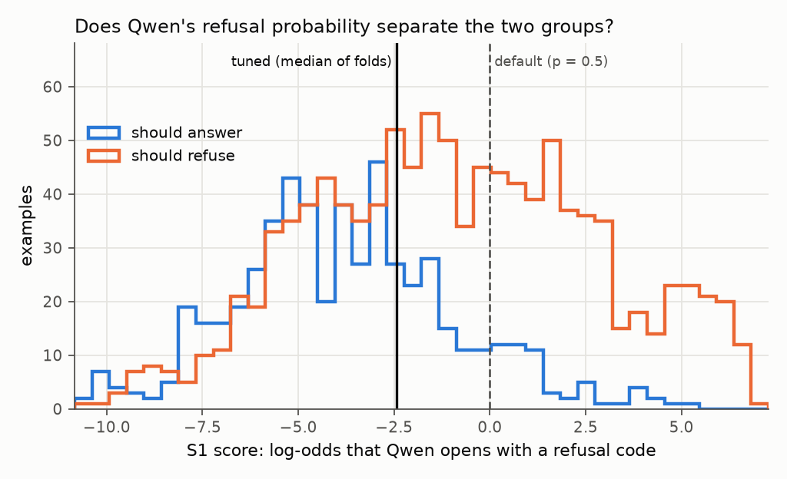
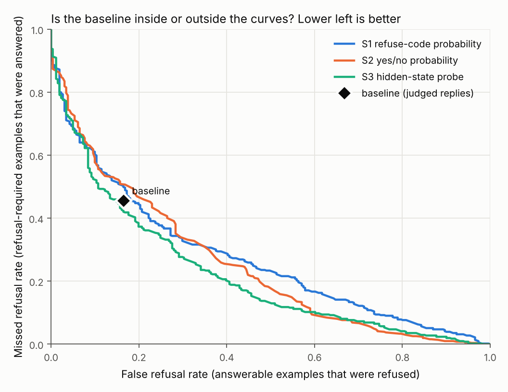

# Reading, Not Asking: extending RefusalBench

**Team:** Mohammad Jomaa (`@<github-handle>`)
**Topic:** Grounding.
**Baseline paper:** Aashiq Muhamed, Leonardo F. R. Ribeiro, Markus Dreyer, Virginia Smith, Mona T. Diab.
*RefusalBench: Generative Evaluation of Selective Refusal in Grounded Language Models.* Proceedings of
the 19th Conference of the European Chapter of the Association for Computational Linguistics (EACL 2026),
Volume 1: Long Papers, pages 6811–6856. arXiv:2510.10390. Code:
[github.com/aashiqmuhamed/refusalbench](https://github.com/aashiqmuhamed/refusalbench).

## Abstract

RefusalBench tests whether a grounded language model answers when its passage supports an answer and
refuses, naming the reason, when the passage is flawed; it finds that small models rarely give the right
reason. We reproduce its single-document benchmark (RefusalBench-NQ, 1,600 examples) for Qwen1.5-7B-Chat
on a free Colab T4 with a Gemini judge: as in the paper, the model almost never names the correct reason
(refusal accuracy 0.114; paper about 0.05) and it misses 45.6% of the refusals it should make. We then
target that weakness without training, in two ways. Asking the model to diagnose the evidence before
answering fails clearly: it writes "CLEAR" on 762 of 800 examples and catches 1.9% of the needed refusals,
against 43.3% for the baseline. Reading its internal signal instead, without generating any text, works
partly: a refusal probability, a yes/no probability and a linear probe on the hidden state separate the
two groups well above chance (AUROC 0.73, 0.75, 0.80), but as answer-or-refuse decisions none clearly
beats the baseline; the best, the probe, gains +0.028 balanced accuracy with a 95% interval of
[-0.014, +0.065]. The information about when to refuse is decodable from the model, but not yet
deployable as a better decision.

## 1. The baseline paper

### 1.1 Problem

Language models used for retrieval-augmented generation must decide **when to answer from the supplied
context and when to refuse** because the context is insufficient or unreliable. The paper calls this
**selective refusal** and treats it as a safety-critical capability that current models fail at:
"refusing over 60% of answerable queries or confidently answering despite critical information defects."

The paper's second problem is **how to measure it**. Static benchmarks become unreliable for this kind of
capability: models learn dataset-specific artifacts, test instances leak into training, and benchmarks
saturate. A model's score then reflects memorized instances rather than the principle being tested (the
logic of a contradiction, say).

The paper defines six kinds of **informational uncertainty**, each with its own refusal code:

| Category | Example from the paper | Expected reply |
|---|---|---|
| Ambiguity | "the bat's weight" when the text has a baseball bat and an animal | `REFUSE_AMBIGUOUS_QUERY` |
| Contradiction | revenue is both $10M and $12M | `REFUSE_CONTRADICTORY_CONTEXT` |
| Missing information | asking for the CEO when the text only describes products | `REFUSE_INFO_MISSING_IN_CONTEXT` |
| False premise | "why did the Mars division fail?" when there is no Mars division | `REFUSE_FALSE_PREMISE_IN_QUERY` |
| Granularity mismatch | a city-wide average income when only two salaries are given | `REFUSE_GRANULARITY_MISMATCH` |
| Epistemic mismatch | "which painting is more beautiful?" given only their dimensions | `REFUSE_NONFACTUAL_QUERY` |

### 1.2 Solution

RefusalBench is a **generative evaluation**: instead of collecting a fixed test set, it creates test
cases by **perturbing answerable question–passage pairs** in controlled ways, so fresh instances can be
generated for every evaluation round.

1. **A perturbation engine.** 176 linguistic "levers" (about 10 for each of the 18 combinations of the
   six categories and three intensities) are instructions for changing a query or its context to
   introduce one kind of uncertainty. Domain experts wrote the core logic of each lever; three frontier
   models (o3, Claude 4 Opus, Gemini 2.5 Pro) wrote examples that were kept only when all three agreed,
   and a human expert validated them.
2. **Three intensities.** LOW perturbations introduce subtle uncertainty that a competent model should
   resolve and **answer**. MEDIUM and HIGH perturbations create a real or severe defect that requires a
   **refusal**.
3. **A generator–verifier pipeline.** Four models (Claude-4-Sonnet, DeepSeek-R1, GPT-4o, Nova-Pro) each
   generate a perturbed instance from a base example and a lever. Every model then verifies every
   generation against seven criteria (including lever fidelity and intensity), and an instance is kept
   **only if all verifiers approve**. The paper justifies the consensus with measured self-evaluation
   bias: models pass their own generations 91.0% of the time against 82.1% for others', with
   inter-verifier agreement as low as κ = 0.061.
4. **Two benchmarks.** **RefusalBench-NQ** starts from 100 Natural Questions whose unperturbed version
   every frontier model answered correctly, with ground-truth KILT passages, so failures come from the
   perturbation, not from the question; stratified sampling gives **1,600 examples, balanced across
   perturbation types and generators** (536 answerable, 1,064 to refuse). RefusalBench-GaRAGe (multi-document) has 1,506. An expert checked 180
   random examples of each: 93.1% (NQ) and 88.3% (GaRAGe) were valid.
5. **Scoring.** The model under test answers or replies with a refusal code. An LLM judge
   (Claude-4-Sonnet) classifies each reply as an answer attempt or a refusal code and scores answers 1 to
   5; a score of 4 or 5 is a **correct answer**, and a refusal is **correct only if its category matches
   exactly**. From these the paper computes answer accuracy, refusal accuracy, false and missed refusal
   rates, refusal-detection F1, category accuracy, a calibrated refusal score and calibration error.

The paper also gives a theoretical reason for generating fresh instances (Theorem 3.1): the error bound
of a static estimator degrades as contamination drift grows, while a generative estimator's does not.

### 1.3 Results

Over 30 models evaluated on both benchmarks:

- **No model reaches 80% on both answering and refusing.** The best refusal accuracy is **73.0%** on
  RefusalBench-NQ (Claude-4-Sonnet) and **47.4%** on RefusalBench-GaRAGe (DeepSeek-R1);
  Claude-4-Sonnet falls from 73.0% to 36.1% on the multi-document set.
- **Refusal is two skills: detection and categorization.** GPT-4o rarely misses a needed refusal (missed
  refusal rate 4.3%) but wrongly refuses over 60% of answerable questions, and names the right category
  only 54.1% of the time.
- **Models default to "missing information"**: it receives 25% of all predictions on NQ, and
  granularity and ambiguity cases are often misfiled there.
- **A trade-off between the two errors**: false and missed refusal rates correlate at r = −0.78 on NQ.
  Refusal rates rise with intensity, so subtle perturbations are the hardest to detect.
- **Miscalibration**: expected calibration error is 0.226–0.519 on refusals and 0.406–0.580 on answers.
- **Scale does not fix it.** For Qwen, answer accuracy jumps from 13.0% to 56.1% between 4B and 7B, but
  refusal accuracy stays **below 17% at every size**. OLMo improves from 5.1% to 19.3%, Llama 3.1×
  from 8B to 70B. Extending Claude-4-Sonnet's reasoning to 4,096 thinking tokens changes refusal
  accuracy by less than 1 point.
- **Alignment helps**: DPO raises OLMo's refusal accuracy over SFT at every scale, 3.4× at 7B. The paper
  concludes that selective refusal is a **trainable, alignment-sensitive** capability and that targeted
  alignment is the most promising path.

For our model, Qwen1.5-7B-Chat on RefusalBench-NQ: **answer accuracy 0.561** (Section 4.2) and **refusal
accuracy about 0.05** (read from Figure 9, a small plot, so approximate).

## 2. Your extension

### 2.1 Motivation

**The limitation we target.** The paper shows that small models fail at selective refusal (Qwen below
17% refusal accuracy at every size) and **measures** this weakness, but the only remedy it points to is
**training** (DPO, targeted alignment). It offers nothing for a small open model whose weights we do not
change. Our reproduction (Section 3.1) confirms the weakness for Qwen1.5-7B-Chat: it names the right
reason for 11.4% of the needed refusals and answers 45.6% of the questions it should refuse.

**Our question:** can a small model's answer-or-refuse decisions be improved **without training**, and
where does the information needed for that decision live?

**How the idea changed.** Our first extension (**Extension 1, diagnose first**) was the idea we pitched
first: make the model write which problem the evidence has before it decides. It was run as planned,
with a format-only control, and failed clearly (Section 3.2). That failure motivated **Extension 2,
reading the signal**: if the model's written diagnosis cannot be trusted, read what it computes before
it writes. The pitch for the switch, and for a narrower claim (better detection of **when** to refuse,
not of **why**), is `extension/ext2_reading_signals/PITCH.md`.

> **To fill in before submission:** the link to the idea-pitch issue (Issue #1) and the date of the
> instructor's approval of each pitch.

### 2.2 Method

Both extensions keep the baseline's model and settings: Qwen1.5-7B-Chat, 4-bit, temperature 1.0,
top-p 1.0, seed 0. The code is in `extension/`, separate from `baseline/`; the extensions call the
baseline's code, never the reverse.

#### Extension 1: diagnose the evidence first (`extension/ext1_diagnose_first/`)

Three conditions on the same 800 examples (`data/novelty_sample_ids.json`: a stratified half of every
answerable-type and refusal-code × intensity stratum, 268 answerable and 532 to refuse, all 100 source
questions):

| Condition | Instruction added to the paper's prompt | Role |
|---|---|---|
| Baseline | none | the paper's method |
| Format-only control | end with one line `FINAL: <answer or refusal code>` | rules out "tidier output" as the explanation |
| **Diagnose first** | first write `EVIDENCE_STATE:` with CLEAR or one of six states, then `FINAL:` | our idea |

The six states map one to one to the refusal codes (`EPISTEMIC_MISMATCH` to `REFUSE_NONFACTUAL_QUERY`).
The definitions of the codes are the paper's, word for word, in every condition (a test checks the text
is identical). A non-CLEAR state **decides** the reply: it becomes its refusal code in software. For
CLEAR, the text after `FINAL:` is the answer (`conditions.py`, `extract_effective`).

**Scoring without a judge** (`analyze_parse_only.py`): a refusal counts only when the reply contains
exactly one clean refusal code, the baseline's own parser. The baseline and control rates are therefore
**lower bounds**; diagnose first's are exact, because its state is read from the text. The comparison
uses the 776 examples all three conditions share (the baseline lost 24 of the 800 to GPU out-of-memory).

#### Extension 2: read the model's signal (`extension/ext2_reading_signals/`)

No text is generated. Each score comes from **one forward pass per example and prompt**; higher always
means "refuse".

- **S1, refusal probability** (`scorer.py`). Under the paper's own prompt, the probability that the
  reply **opens** with a refusal code. A code is several tokens and Qwen sometimes wraps it, so for each
  wrapper *w* ∈ {none, `**`, `` ` ``, `ANSWER:`, `Answer:`} we take the longest token prefix *v_w*
  shared by all seven codes, score it by teacher forcing, and sum over the mutually exclusive openings:

  $$p_{\text{ref}}(x)=\sum_{w}\prod_{t=1}^{|v_w|}P\left(v_{w,t}\mid x, v_{w,<t}\right),\qquad s_1=\log\frac{p_{\text{ref}}}{1-p_{\text{ref}}}.$$

  The wrapped forms are about 30% of the baseline's coded refusals. The untuned threshold is
  $p_{\text{ref}}=0.5$.
- **S2, yes/no sufficiency.** A second prompt asks whether the query can be answered completely and
  faithfully from the passage, "Yes or No"; $s_2=\log P(\text{No})-\log P(\text{Yes})$ on the first
  token. The untuned threshold is No > Yes.
- **S3, linear probe.** Logistic regression (standardized, PCA to 128 dimensions, class-balanced) on the
  last-token hidden state, from either prompt and from the last or the middle layer; the layer, the
  prompt and the regularization are chosen by an inner grouped cross-validation. **S3 is trained on the
  benchmark's labels; the baseline is not**, so we treat it as a diagnostic of what the hidden state
  contains, not as an equal-training replacement for the baseline.

A decision is "refuse if the score is above a threshold". Two kinds of rule: **default thresholds** (S1,
S2) use no labels, the cleanest comparison with the baseline; **tuned thresholds** (chosen to maximize
balanced accuracy) and the probe use labels.

**No leakage.** The 1,600 examples come from only 100 source questions. Everything fitted is
**cross-fitted over source questions in 5 folds**: an example's own source question is never in the data
used to choose its threshold or fit its probe. Held-out decisions are pooled for evaluation. A unit test
corrupts one fold's labels and checks that this fold's threshold does not change.

**The success rule was fixed before the run.** Signal: the lower end of S1's AUROC interval is above 0.5.
Gain: the tuned S1 threshold beats the default in balanced accuracy, with the interval of the difference
above 0. Both true: SUPPORTED; only the first: SIGNAL BUT NO GAIN; neither: NOT SUPPORTED.

**Comparison with the baseline** (`compare_to_baseline.py`): on the same examples as the graded baseline
replies, where a baseline reply is a refusal when the judge classifies it as any refusal code (a
free-text refusal the judge recognized counts; a mistyped code is mapped to the closest valid one). A
rule is **BETTER** when the whole 95% interval of its balanced-accuracy difference is above 0, **WORSE**
when below, and otherwise shows **NO CLEAR DIFFERENCE**.

#### Measures and intervals (both extensions)

Balanced accuracy, $\text{BA}=1-\tfrac12(\text{FRR}+\text{MRR})$, where FRR is the false refusal rate
(answerable but refused) and MRR the missed refusal rate (must refuse but answered). 0.5 is a coin flip
whatever the class balance, which matters because two thirds of the examples must be refused. All
intervals are **cluster bootstrap over source questions**, 2,000 resamples, seed 0, paired across
conditions. The resampling covers the pooled held-out predictions; the fitting is not repeated inside
each resample, so the intervals reflect the sampling of the evaluation examples, not the variability of
the fitted thresholds or probe.

### 2.3 Implementation notes

- **Hardware and cost.** Everything ran on a free Google Colab T4 (15 GB). Qwen1.5-7B-Chat is about
  15 GB at 16-bit, so it runs in 4-bit NF4 (bitsandbytes) with Hugging Face Transformers, about 5 GB.
  Total API spend: **$0** (free Gemini tier), inside the course's $20 limit.
- **Speed.** Baseline and Extension 1 generation: about 6 s per reply (all 1,600 in about 2.6 hours).
  Extension 2 scoring: about 0.3 s per example and prompt (two passes over 1,600 in about 15 minutes).
- **Judge.** `gemini-3.5-flash-lite` at temperature 0 with the paper's judge prompt verbatim, used only
  for replies without exactly one clean refusal code (parse-first scoring). The free tier allows about
  500 calls per day, which is why only 770 baseline replies are graded.
- **Robust runs.** Every stage writes append-only files and resumes after a Colab disconnect; a settings
  lock refuses to mix configurations in one run folder; a GPU out-of-memory batch is retried one example
  at a time.
- **Data.** RefusalBench-NQ is downloaded from Hugging Face at run time (`data/README.md`). No personal
  data.
- **Configuration.** `baseline/configs/`, `extension/ext1_diagnose_first/configs/`,
  `extension/ext2_reading_signals/configs/ext2.yaml`.
- **Running it.** `baseline/README.md` and each extension's README give the exact commands and Colab
  notebooks. The tests (`pytest -q`) need no GPU, no key and no network; several of them recompute the
  numbers reported below from the committed run files.

## 3. Results

### 3.1 Reproduction of the baseline

Qwen1.5-7B-Chat on RefusalBench-NQ. Replies were generated for 1,560 of 1,600 examples (40 failed with
GPU out-of-memory, 2.5%); **770 are graded** so far, a seeded random sample (509 must refuse, 261
answerable).

| Metric | Paper | Ours (770 graded) |
|---|---:|---:|
| Answer accuracy (judge score 4 or 5) | **0.561** | **0.690** |
| Refusal accuracy (refused, exact category) | **≈ 0.05** | **0.114** |
| False refusal rate | — | 0.165 |
| Missed refusal rate | — | 0.456 |
| Refusal-detection F1 | — | 0.668 |
| Balanced accuracy (detection) | — | 0.690 |

**What reproduces is the paper's finding, not its exact numbers.** As in the paper, Qwen1.5-7B almost
never names the correct reason for refusing, and it misses many refusals. Our answer accuracy is higher
than the paper's, but the judge, the precision and the inference software all differ, so we do not read
it as an improvement.

By type, the baseline misses most refusals for **ambiguity (0.74)** and **contradiction (0.71)**, few for
false premise (0.19), granularity (0.25) and epistemic mismatch (0.30), and over-refuses answerable
false-premise examples (false refusal 0.33).

Only 528 of the 1,560 replies (34%) are a clean refusal code. The other 1,032 (64%) are free text (991),
an unknown code (40, mostly a truncated `REFUSE_INFO_MISSING_IN`) or several codes (1), and need the
judge. A reply without a code is never assumed to be an answer, because a small model often refuses in
plain words.

**Deviations from the paper:** one T4 with Transformers instead of 4 × A100 with vLLM; 4-bit weights
(the paper does not state its precision, likely 16-bit; we did not measure the effect); Gemini instead
of Claude-4-Sonnet as judge, used only for replies without a clean code; one seed; `max_new_tokens` 256
(not stated in the paper). This is a close reproduction with documented deviations, a **smoke test** in
the course's sense; Section 5 states what a full run needs.

### 3.2 Extension versus baseline

#### Extension 1: diagnose first

On the 776 shared examples (517 must refuse, 259 answerable, 99 source questions), clean refusal codes
only:

| Condition | Refusals detected | Correct category | False refusal |
|---|---:|---:|---:|
| Baseline | 43.3% | 6.8% | 15.4% |
| Format-only control | 35.8% | 3.3% | 7.7% |
| **Diagnose first** | **1.9%** | **0.0%** | 0.4% |

| Difference, points [95% interval] | Refusals detected | Correct category |
|---|---:|---:|
| Diagnose first − control | −33.8 [−38.2, −29.5] | −3.3 [−4.8, −2.0] |
| Diagnose first − baseline | −41.4 [−46.1, −36.7] | −6.8 [−9.2, −4.6] |
| Control − baseline | −7.5 [−11.3, −3.9] | −3.5 [−5.9, −1.3] |

Every interval excludes zero. The control is itself slightly worse than the baseline, so formatting
alone does not explain the collapse.

What the model wrote as its evidence state, on all 800:

| True class | n | CLEAR | Other valid state | Missing or malformed |
|---|---:|---:|---:|---:|
| Answerable | 268 | 258 | 0 | 10 |
| Ambiguity | 69 | 68 | 0 | 1 |
| Contradiction | 94 | 87 | 1 | 6 |
| Missing information | 92 | 87 | 0 | 5 |
| False premise | 93 | 89 | 2 | 2 |
| Granularity mismatch | 92 | 83 | 4 | 5 |
| Epistemic mismatch | 92 | 90 | 0 | 2 |

**762 of 800** were CLEAR, including **504 of the 532** that had to be refused. The only valid non-CLEAR
state it ever wrote was `MISSING_INFORMATION` (7 times); malformed states were `CLARITY`, `CLEARS`,
`_CLEAR` and similar. Even if every non-CLEAR reply had been a perfect refusal, the ceiling was 38 of 800.

*Source: `extension/ext1_diagnose_first/results/parse_only_comparison.md`, produced by
`analyze_parse_only.py`. The intervals differ by at most 0.2 points from the ones in our first analysis,
whose code was not kept; the point estimates are identical.*

#### Extension 2: reading the signal

**A. Is the information inside the model?** All 1,600 examples, cross-fitted:

| Readout / rule | AUROC [95%] | False refusal | Missed refusal | Balanced accuracy | F1 |
|---|---|---:|---:|---:|---:|
| S1 refusal probability | 0.726 [0.699, 0.752] | | | | |
|   default (p > 0.5) | | 0.103 | 0.590 | 0.654 | 0.561 |
|   tuned threshold | | 0.256 | 0.408 | 0.668 | 0.688 |
| S2 yes/no | 0.751 [0.723, 0.777] | | | | |
|   default (No > Yes) | | 0.125 | 0.540 | 0.667 | 0.604 |
|   tuned threshold | | 0.321 | 0.329 | 0.675 | 0.732 |
| S3 hidden-state probe | 0.797 [0.770, 0.825] | 0.250 | 0.307 | **0.721** | 0.762 |

All three separate the groups well above chance (0.5). The probe has the highest AUROC (S3 − S1:
+0.071 [+0.041, +0.102]); S2 is slightly above S1 (S1 − S2: −0.025 [−0.047, −0.003]). The probe chose a
middle-layer state in four of the five folds. **Pre-registered verdict: SIGNAL BUT NO GAIN.** The signal
check passes (lower end 0.699); the gain check fails: tuning S1's threshold changes balanced accuracy by
+0.015 [−0.008, +0.036]. It only moves the operating point along one trade-off curve (missed refusal 0.59
to 0.41, false refusal 0.10 to 0.26).

**B. Does using it beat the baseline?** The same 770 examples as the graded baseline (509 must refuse,
261 answerable, 99 source questions):

| Rule | False refusal | Missed refusal | Balanced accuracy | Rule − baseline [95%] | Verdict | Labels? |
|---|---:|---:|---:|---:|---|---|
| **Baseline** (judged replies) | 0.165 | 0.456 | **0.690** [0.656, 0.724] | | | no |
| S1 default | 0.103 | 0.580 | 0.658 | −0.031 [−0.057, −0.005] | worse | no |
| S1 tuned | 0.261 | 0.397 | 0.671 | −0.018 [−0.047, +0.009] | no clear difference | yes |
| S2 default | 0.115 | 0.546 | 0.669 | −0.020 [−0.047, +0.007] | no clear difference | no |
| S2 tuned | 0.337 | 0.326 | 0.668 | −0.021 [−0.056, +0.014] | no clear difference | yes |
| **S3 probe** | 0.276 | **0.289** | **0.718** | **+0.028 [−0.014, +0.065]** | no clear difference | yes |

Counting only clean codes would put the baseline at about 0.64; the judge raises it to 0.690, which
shows how much a code-only reading understates the baseline. With five comparisons and no correction for
multiple testing, the one "worse" verdict is not robust.

The baseline's operating point lies close to the S1 and S2 trade-off curves and just above the probe's:
a single global threshold leaves little room (a visual observation, not a test).

**By uncertainty type** (missed / false refusal, the same 770 examples; 40 to 93 examples per cell, so
descriptive only):

| Type | Baseline | S1 tuned | S2 tuned | S3 probe |
|---|---|---|---|---|
| Ambiguity | 0.74 / 0.09 | 0.66 / 0.11 | 0.55 / 0.21 | 0.45 / 0.23 |
| Contradiction | 0.71 / 0.17 | 0.63 / 0.24 | 0.23 / 0.50 | 0.19 / 0.29 |
| Missing information | 0.56 / 0.22 | 0.51 / 0.39 | 0.49 / 0.34 | 0.53 / 0.37 |
| Epistemic mismatch | 0.30 / 0.12 | 0.19 / 0.14 | 0.30 / 0.19 | 0.12 / 0.19 |
| False premise | 0.19 / 0.33 | 0.20 / 0.50 | 0.16 / 0.47 | 0.25 / 0.23 |
| Granularity mismatch | 0.25 / 0.10 | 0.19 / 0.23 | 0.25 / 0.33 | 0.19 / 0.35 |

S2 and the probe recover many of the contradictions and ambiguities the baseline misses, but refuse
more answerable questions of those types. The probe is the only rule that lowers false refusal on false
premise (0.23 against 0.33), at the price of more missed false-premise refusals.

*Sources: `extension/ext2_reading_signals/results/` (`RESULT_AUTO.md`, `metrics.json`, `scores.csv`) and
`results/comparison_all/COMPARISON.md`, recomputed by `compare_to_baseline.py` from `scores.csv` and the
committed baseline run.*

### 3.3 Honest assessment

**What worked.**
- The reproduction: the pipeline runs end to end on free resources, every deviation is documented, and
  the paper's qualitative finding appears for our model.
- Finding the signal: the model's own probabilities and hidden states carry substantial information
  about whether a refusal is needed (AUROC up to 0.80), information its generated replies use poorly.
- Rigor that held up: a control condition, cross-fitting that keeps variants of one question together,
  intervals that resample source questions, and success rules fixed before the runs. Applied
  mechanically, those rules gave verdicts we did not want, and we report them as they came out.

**What did not work.**
- Diagnose first, clearly: asking the model to reason about the evidence produced its worst behavior.
- Turning the signal into a better decision: no rule clearly beats the baseline. The label-free
  thresholds do not; the probe has a small positive point estimate with an interval that includes zero,
  and it uses labels the baseline never sees.

**What we do not know.**
- **Why diagnose first fails.** The model may anchor on CLEAR, the first option listed, but we tested
  nothing about the mechanism, so that is a guess, not a finding.
- **Whether the probe's +0.028 is real.** Half of the baseline is graded; with all of it the interval
  narrows and could exclude zero, or not.
- **Whether Gemini grades like the paper's Claude.** Most baseline replies depend on the judge, and the
  planned 30-reply hand check is not done. This is the main threat to the comparison in Part B.

**The central finding, in one line: decodable is not deployable.** Information about when to refuse can
be read out of a small model, but simple readouts do not yet turn it into clearly better decisions than
the model's own.

## 4. Related work

**Follow-up work on RefusalBench.** We searched arXiv, the ACL Anthology and the web (20 October 2026)
for work that builds on or cites RefusalBench. We found one: **HopRefusalBench** (Xie et al., 2026),
which cites RefusalBench's split between detecting when to refuse and categorizing why, and builds a new
benchmark of 889 unanswerable multi-hop questions for search-augmented agents. It evaluates ten models as
they are and proposes no method to improve refusal. **How we differ:** we stay on RefusalBench's own
single-document benchmark and test two ways to improve a small model's decisions without training. We
found **no published work** that proposes a training-free improvement on RefusalBench. (A different
paper, *RefusalBench: Why Refusal Rate Misranks Frontier LLMs on Biological Research Prompts*,
arXiv:2605.21545, shares the name but studies safety refusals and is unrelated.)

**Unanswerable questions and abstention.** SQuAD 2.0 (Rajpurkar et al., 2018) made models abstain when
the passage lacks the answer; RefusalBench generalizes this to six controlled kinds of evidence failure.
Yin et al. (2023) ask whether models recognize questions they cannot answer. **R-Tuning** (Zhang et al.,
2024) trains a model to say "I don't know" for questions beyond its knowledge, and **Self-RAG** (Asai et
al., 2023) trains a model to critique its own retrieval and generation. **How we differ:** these improve
abstention by fine-tuning or self-reflective training; we keep the weights fixed and read signals the
model already produces.

**What models know about themselves.** Models can be well calibrated about whether they know an answer
when asked in the right format (Kadavath et al., 2022). Linear probes read information from intermediate
layers (Alain and Bengio, 2016), and truthfulness signals have been recovered from hidden states with and
without supervision (Burns et al., 2023; Azaria and Mitchell, 2023). **How we differ:** we apply the same
idea to a different target, whether the **evidence** supports answering, and compare it against the
benchmark's own baseline.

**Selective prediction.** A classifier can abstain below a confidence threshold, trading coverage for
risk (Geifman and El-Yaniv, 2017), and a confidence is only useful if calibrated (Guo et al., 2017). Our
threshold rules are selective prediction with the model's own refusal probability as the confidence.

**Evaluation methods.** We use an LLM judge (Zheng et al., 2023) as the paper does, and the cluster
bootstrap (Cameron et al., 2008; Efron and Tibshirani, 1993) because the benchmark's examples are
variants of a few source questions.

## 5. Limitations and what full validation would require

**Limitations.**
1. One model, one benchmark (the single-document set), one seed, 4-bit weights, sampling at temperature
   1.0.
2. The judge is Gemini, not the paper's Claude, and is not yet validated by hand. Most baseline replies
   depend on it while the Extension 2 rules do not, so this is the main threat to the comparison.
3. The baseline is half graded (770 of 1,560), and 40 examples (2.5%, somewhat longer inputs) are
   excluded.
4. Extension 1: the 800-example sample, prompts not piloted before the runs, and lower bounds for the
   baseline and the control because free-text refusals are not counted without the judge.
5. Extension 2: the probe is supervised; cross-fitting prevents leakage between source questions but not
   the shift to a different distribution. S1 sees only replies that open with a code. Detection only: no
   reason for refusing, no answer correctness. The intervals do not include the variability of the
   fitted thresholds. Five comparisons with no correction for multiple testing.

**What full validation would need.** All of it fits the course's cost limit.

| Part | What | Size | Cost |
|---|---|---|---|
| Baseline | Grade the other 790 replies | about 534 judge calls | $0, one more day of the free Gemini quota (or a key from a second project) |
| Baseline | Regenerate the 40 out-of-memory examples | one at a time on the T4 | $0, minutes |
| Baseline | Validate the judge | 30 graded replies checked by hand (`baseline/results/handcheck_sheet.csv`) | about an hour of reading |
| Baseline | A closer match to the paper | Claude-4-Sonnet as judge (about 1,000 calls), 16-bit weights on a GPU with at least 16 GB, several seeds | a few dollars of API calls; a GPU beyond the free T4 |
| Extension 1 | Judge the replies, for answer accuracy and free-text refusals | about 920 judge calls | $0, about 2 days of free quota |
| Extension 1 | Pilot and freeze the prompts on the dev pool; test the CLEAR-first guess by reordering the options | 2 more runs of 800 | $0, about 3 hours of T4 time |
| Extension 2 | Rerun the comparison on the fully graded baseline | `compare_to_baseline.py` | $0, seconds |
| Extension 2 | An equal-training comparison: 5 sampled replies per example, a threshold tuned on the share that refuse | 5 × 1,600 generations | $0, about 13 hours of T4 time |
| Extension 2 | Correct for the five comparisons (Holm) | analysis only | $0 |
| Both | Other models, and the multi-document RefusalBench-GaRAGe | 2 more models × 1,600 examples | $0 on Colab; generation about 2.6 hours, scoring under an hour per 7B model |

## References

1. A. Muhamed, L. F. R. Ribeiro, M. Dreyer, V. Smith, M. T. Diab. RefusalBench: Generative Evaluation of
   Selective Refusal in Grounded Language Models. *Proc. EACL 2026*, Long Papers, pp. 6811–6856.
   arXiv:2510.10390.
2. J. Bai et al. Qwen Technical Report. arXiv:2309.16609, 2023.
3. Qwen Team. Introducing Qwen1.5. Qwen blog, https://qwenlm.github.io/blog/qwen1.5/, 2024.
4. T. Kwiatkowski et al. Natural Questions: A Benchmark for Question Answering Research. *TACL* 7:453–466,
   2019.
5. P. Lewis et al. Retrieval-Augmented Generation for Knowledge-Intensive NLP Tasks. *NeurIPS*, 2020.
6. P. Rajpurkar, R. Jia, P. Liang. Know What You Don't Know: Unanswerable Questions for SQuAD. *ACL*, 2018.
7. S. Kadavath et al. Language Models (Mostly) Know What They Know. arXiv:2207.05221, 2022.
8. C. Burns, H. Ye, D. Klein, J. Steinhardt. Discovering Latent Knowledge in Language Models Without
   Supervision. *ICLR*, 2023.
9. A. Azaria, T. Mitchell. The Internal State of an LLM Knows When It's Lying. arXiv:2304.13734, 2023.
10. G. Alain, Y. Bengio. Understanding Intermediate Layers Using Linear Classifier Probes.
    arXiv:1610.01644, 2016.
11. Y. Geifman, R. El-Yaniv. Selective Classification for Deep Neural Networks. arXiv:1705.08500, 2017.
12. C. Guo, G. Pleiss, Y. Sun, K. Q. Weinberger. On Calibration of Modern Neural Networks. *ICML*, 2017.
13. T. Dettmers, A. Pagnoni, A. Holtzman, L. Zettlemoyer. QLoRA: Efficient Finetuning of Quantized LLMs.
    arXiv:2305.14314, 2023.
14. T. Wolf et al. Transformers: State-of-the-Art Natural Language Processing. *EMNLP: System
    Demonstrations*, pp. 38–45, 2020.
15. L. Zheng et al. Judging LLM-as-a-Judge with MT-Bench and Chatbot Arena. *NeurIPS Datasets and
    Benchmarks*, 2023.
16. A. C. Cameron, J. B. Gelbach, D. L. Miller. Bootstrap-Based Improvements for Inference with Clustered
    Errors. *Review of Economics and Statistics* 90(3):414–427, 2008.
17. B. Efron, R. J. Tibshirani. *An Introduction to the Bootstrap*. Chapman & Hall, 1993.
18. Z. Yin et al. Do Large Language Models Know What They Don't Know? *Findings of ACL*, 2023.
19. H. Zhang et al. R-Tuning: Instructing Large Language Models to Say 'I Don't Know'. *NAACL*, 2024.
20. A. Asai, Z. Wu, Y. Wang, A. Sil, H. Hajishirzi. Self-RAG: Learning to Retrieve, Generate, and Critique
    through Self-Reflection. arXiv:2310.11511, 2023.
21. J. Xie et al. HopRefusalBench: Diagnosing Refusal Failures in Search-Augmented Agents for Multi-Hop
    Reasoning. arXiv:2608.01358, 2026.

Code, data and every reported number: this repository. Each number above is recomputed from committed
files by the tests in `tests/`.
